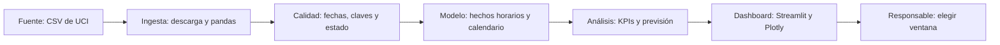

# Planificación del mantenimiento de bicicletas compartidas en Seúl

## 1. Propuesta y decisión

Este proyecto propone un dashboard para elegir franjas de mantenimiento con menor actividad en un servicio de bicicletas compartidas. Utiliza datos históricos de Seúl y añadirá una previsión horaria en el bloque de modelización. Busca reducir la coincidencia entre mantenimiento y uso intenso, manteniendo las horas de trabajo.

La organización de referencia es el servicio público de bicicletas de Seúl, que facilita desplazamientos urbanos mediante alquileres. Se plantea un departamento de mantenimiento preventivo, cuya responsable revisaría semanalmente el dashboard y confirmaría diariamente los horarios. Este funcionamiento es un supuesto del proyecto.

**Con esta solución, la responsable decidirá en qué ventana diurna de dos horas programar tareas preventivas que reduzcan temporalmente la disponibilidad del servicio.**

Se compararán ventanas consecutivas comprendidas entre las 09:00 y las 18:00, con inicios de 09:00 a 16:00. Estos horarios y la duración son restricciones propuestas para el caso. Se mantendrán constantes las horas de trabajo y se excluirán intervenciones urgentes. No hay datos de costes, plantilla ni bicicletas disponibles: la herramienta ordenará alternativas, sin calcular ahorro económico ni dimensionar equipos.

La decisión contribuye a la continuidad del servicio y afecta a usuarios y personal. Se comparará con un calendario fijo para comprobar si la mejora justifica gestionar horarios diferenciados.

## 2. Dataset y calidad

### Ficha del dataset

| Campo | Respuesta |
|---|---|
| Nombre | Seoul Bike Sharing Demand |
| Publicador y URL | UCI Machine Learning Repository. Registros del sistema de bicicletas de Seúl con información meteorológica. [Ficha y diccionario](https://archive.ics.uci.edu/dataset/560/seoul+bike+sharing+demand). |
| Licencia | [Creative Commons Attribution 4.0 International, CC BY 4.0](https://creativecommons.org/licenses/by/4.0/). Se conservará la atribución al dataset. |
| Descarga y versión | Descargado el 20/10/2026. UCI indica incorporación el 29/02/2020; no muestra una versión numerada. Copia identificada por SHA-256 en la auditoría adjunta. |
| Granularidad | Una fila por fecha y hora para el conjunto del sistema. La clave será la combinación `Date` + `Hour`. El recuento representa alquileres, no personas únicas ni bicicletas disponibles. |
| Periodo | 01/12/2017 00:00–30/11/2018 23:00: doce meses completos. |
| Tamaño comprobado | 8.760 filas × 14 columnas; CSV de 604.166 bytes, aproximadamente 0,604 MB decimales. |
| Fechas y dimensiones | `Date` identifica el día y `Hour` toma valores de 0 a 23. `Seasons` distingue invierno, primavera, verano y otoño; `Holiday`, festivo y no festivo; `Functioning Day`, funcionamiento y cierre. Día de semana y mes se derivarán de la fecha. Estos campos permitirán filtrar el dashboard y comparar situaciones equivalentes. |
| Medidas y objetivo | `Rented Bike Count` es el recuento horario y el objetivo predictivo. Las variables meteorológicas describen temperatura y punto de rocío (°C), humedad (%), viento (m/s), visibilidad (unidades de 10 m), radiación solar (MJ/m²), lluvia (mm) y nieve (cm). Aportan contexto para interpretar variaciones de actividad. |
| Calidad observada | Cero celdas nulas, filas duplicadas, horas duplicadas u horas ausentes. Hay 295 horas sin funcionamiento, todas con cero alquileres, y 8.465 horas operativas, ninguna con recuento cero. Existen 432 registros horarios festivos. El recuento máximo observado es de 3.556 alquileres por hora; la temperatura abarca de −17,8 a 39,4 °C. Los extremos se conservarán hasta revisar su contexto. |
| Comprobaciones de carga | Conversión explícita de fechas, unicidad de fecha-hora, continuidad horaria, recuentos no negativos y categorías esperadas. La auditoría conserva las dimensiones, los rangos y la huella SHA-256 para identificar la copia utilizada. |
| Fuentes adicionales | Ninguna necesaria para esta entrega. Un uso operativo futuro necesitaría registros actuales, restricciones de mantenimiento y, si se emplea, previsión meteorológica disponible antes de decidir. |

Las cifras proceden de la [auditoría reproducible](evidence/data-audit.json) del CSV descargado. El dataset cumple los mínimos de volumen, periodo, categorías, medidas, documentación, licencia y objetivo predictivo.

Se leerá con codificación Windows-1252 y fecha explícita `día/mes/año`. Los ceros de las 295 horas cerradas permanecerán en el histórico, pero se excluirán del análisis de actividad operativa. Las 8.465 observaciones restantes se repartirán entre entrenamiento, validación y prueba. Se conservarán las unidades originales y se revisarán los extremos meteorológicos sin eliminarlos automáticamente.

Los datos registran alquileres realizados, no demanda insatisfecha. Carecen de estaciones, inventario y causas de cierre; por ello no permiten localizar faltas de bicicletas ni atribuir cierres al mantenimiento. Además, solo cubren un ciclo anual antiguo: las conclusiones serán retrospectivas y requerirán validación con datos recientes antes de aplicarse.

## 3. Hipótesis y pruebas

Las hipótesis están pendientes de contraste. Sus umbrales son propuestas, no resultados ni compromisos del operador. «Estación» significa estación del año; «tipo de día», laborable, fin de semana o festivo, prevaleciendo festivo. Se mostrarán tamaño muestral y dispersión.

### H1. Adaptar la ventana al calendario reduce la actividad coincidente

**Afirmación:** elegir la ventana por estación y tipo de día reduce al menos un 15 % los alquileres coincidentes respecto a una ventana fija. La métrica será `100 × (actividad fija − actividad adaptada) / actividad fija`, con los mismos días elegibles.

Se espera una reducción. Ambas reglas elegirán la ventana de menor media histórica, global o por grupo, utilizando solo datos anteriores. Se compararán los totales en semanas posteriores mediante tabla y gráfico, excluyendo días con cierres en cualquiera de las ventanas comparadas. Si se cumple, se propondrá un calendario diferenciado; si no, el horario fijo. H1 es prioritaria por su vínculo directo con la decisión.

### H2. La lluvia se asocia con menor actividad en horas comparables

**Afirmación:** la media de alquileres con lluvia (`Rainfall(mm)>0`) es al menos un 25 % inferior a la de horas secas, comparando misma estación, hora y tipo de día. La métrica será `100 × (1 − media con lluvia / media sin lluvia)` por grupo operativo comparable.

Se esperan valores positivos. Tablas y diagramas de caja mostrarán grupos con al menos diez horas de cada condición; los demás quedarán inconclusos. Se contrastará el umbral sobre la media de las reducciones, ponderada por horas lluviosas. Si se cumple, se estudiarán previsiones meteorológicas para programar tareas interiores; si no, se mantendrá el calendario. H2 tiene prioridad intermedia. La asociación no prueba causalidad.

### H3. Los festivos requieren un horario específico

**Afirmación:** en festivos, la proporción de alquileres entre las 09:00 y las 13:00 aumenta al menos diez puntos porcentuales respecto a días no festivos del mismo día de semana y estación.

La métrica diaria será `100 × alquileres de 09:00–12:59 / alquileres diarios`, en días completamente operativos. Se promediarán las diferencias entre cada festivo y sus controles comparables, mostrando perfiles horarios. Se exigirán cinco festivos comparables y tres controles por festivo; de lo contrario, el resultado será inconcluso. Si se cumple, se propondrá una regla festiva; si no, la general. Su prioridad es menor por la escasez de festivos.

## 4. Indicadores del dashboard

Todos los indicadores respetarán los filtros seleccionados. Un denominador nulo se mostrará como «no disponible». Los objetivos siguientes son propuestas del proyecto.

| KPI | Definición y fórmula | Grano y comparación | Objetivo |
|---|---|---|---|
| Alquileres realizados | Suma de `Rented Bike Count` | Día; estación y tipo de día | Contexto, sin meta de crecimiento |
| Actividad por hora operativa | Alquileres / número de horas con funcionamiento | Semana; hora y estación | Identificar franjas de menor actividad |
| Actividad coincidente con mantenimiento | Suma de alquileres en la ventana candidata de dos horas | Día; regla fija frente a adaptada | Reducción relativa ≥15 % en evaluación de H1 |
| Horas sin funcionamiento | `100 × horas no operativas / horas registradas` | Mes; comparación temporal | Vigilancia, sin atribuir causas |
| Error absoluto medio, MAE | Media de `abs(alquileres reales − previstos)` | Hora operativa, resumida por semana y tipo de día | Mejorar ≥10 % frente a la referencia temporal |

La actividad coincidente es una aproximación a exposición al impacto, no viajes efectivamente perdidos. Minimizarla debe equilibrarse con horarios laborales y seguridad. Un MAE menor tampoco garantiza una mejor ventana: se revisarán ambos resultados.

Por ejemplo, dos ventanas con actividad similar podrían requerir desplazamientos distintos del equipo. La responsable podrá elegir la segunda mejor alternativa si resulta más viable. El dashboard mostrará los valores comparados y la cobertura de datos para que pueda justificar esa elección.

## 5. Solución y arquitectura

La solución principal será un **dashboard de gestión en Streamlit**, con un motor de previsión posterior. Recibirá alquileres históricos, calendario y estado del servicio; calculará perfiles y ordenará ventanas por actividad prevista. Mostrará indicadores, un mapa de calor horario y alternativas, filtrables por fecha, estación y tipo de día.

Se emitirá a las 08:00 una previsión para las ventanas de ese día, con calendario y alquileres anteriores. La meteorología observada se reservará al análisis retrospectivo. Se comparará un modelo de árboles con la misma hora de la semana anterior; si esta no fue operativa, se usará la media histórica de esa hora.

La separación será temporal: diciembre–julio para entrenamiento, agosto–septiembre para validación y octubre–noviembre para prueba final. Transformaciones y decisiones se ajustarán sin consultar la prueba. La evaluación tendrá cortes sucesivos y reconocerá que un único año limita la generalización estacional. Si una estación o tipo de día carece de antecedentes suficientes, se aplicará la regla global por hora y se señalará esa limitación. Los retardos solo utilizarán observaciones anteriores a la emisión.

| Capa | Función en el proyecto | Herramienta | Actualización |
|---|---|---|---|
| Fuente | Conservar el archivo y su atribución | CSV y SHA-256 | Copia histórica fija |
| Ingesta | Cargar y validar columnas esperadas | Python/pandas | Descarga inicial; nuevas versiones revisadas |
| Calidad | Validar fechas, claves, unidades y cierres | pandas | Cada carga |
| Modelo de datos | Tabla horaria relacionada con calendario por fecha | Parquet | Tras una carga válida |
| Análisis/motor | Agregar indicadores y ordenar ventanas | pandas/scikit-learn | Al recalcular; modelo versionado |
| Dashboard | Mostrar filtros, tendencias y alternativas | Streamlit/Plotly | Tras publicar una versión válida |

El autor del proyecto mantendrá código, documentación y copia original en `project/`; los datos tratados se guardarán en `data/processed/`. La implementación será posterior a este brief. Se elige esta arquitectura por su tamaño reducido y ejecución local, evitando una base de datos innecesaria.

Cada actualización conservará un registro de fecha, filas cargadas e incidencias. Así podrán rastrearse discrepancias entre el archivo original, los indicadores y la recomendación.

La fuente histórica no recibe una actualización diaria prometida. En un despliegue futuro, operaciones validaría una carga diaria y revisaría el calendario semanalmente. Ante cambios de formato se detendrá la carga, se notificará al responsable y se conservará la última versión válida, indicando su fecha.

Los riesgos principales son la antigüedad y cobertura limitada, la interpretación de cierres como baja demanda y la falta de información sobre capacidad. Se mitigarán con validación reciente, separación de estados y decisiones limitadas a horarios. Los registros agregados no incluyen identificadores personales; cualquier futura fuente individual exigiría minimizar datos y revisar permisos. Se mantendrán la atribución CC BY 4.0 y la revisión humana de las recomendaciones.

## Referencias

- UCI Machine Learning Repository (2020). *Seoul Bike Sharing Demand*. [DOI: 10.24432/C5F62R](https://doi.org/10.24432/C5F62R).
- [Licencia CC BY 4.0](https://creativecommons.org/licenses/by/4.0/).
- [Auditoría local del archivo original](evidence/data-audit.json), reproducible mediante [audit_data.py](scripts/audit_data.py).
